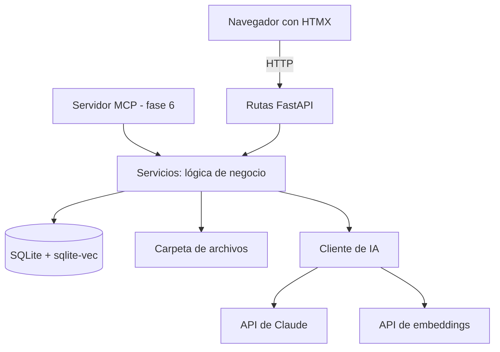
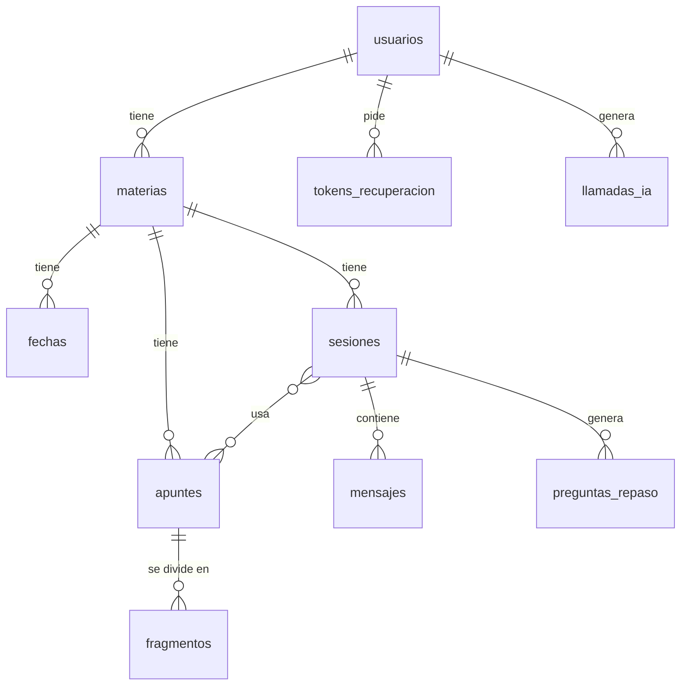

# Cursada: diseño técnico

Versión 0.2 · 12 de octubre de 2026 · Autor: Lauti · Basado en `PRD.md` v0.2

Este documento describe **cómo** se construye lo que define el PRD. Las decisiones de diseño están registradas en la sección 7.

## 1. Stack

| Capa | Tecnología | Motivo |
| --- | --- | --- |
| Backend | Python 3.12 + FastAPI | Buen soporte para la API de Claude y para MCP |
| Plantillas | Jinja2 | El servidor devuelve HTML listo |
| Interactividad | HTMX | Actualiza partes de la página sin escribir JavaScript |
| Base de datos | SQLite + `sqlite-vec` | Un solo archivo, sin servidor; `sqlite-vec` guarda los vectores para RAG |
| Acceso a datos | SQLModel | Ver D1 |
| Migraciones | Alembic | Ver D2 |
| Contraseñas | Hash con Argon2 (`pwdlib`) | Nunca se guarda la contraseña en texto plano |
| Sesión del usuario | Cookie firmada | Simple y compatible con HTML renderizado en el servidor |
| PDFs | `pypdf` | Extraer texto de los apuntes |
| IA | SDK oficial `anthropic` | Generación, extracción de fechas, respuestas con citas |
| Embeddings | Proveedor externo (por ejemplo, Voyage AI) | Claude no genera embeddings |
| Tests | pytest | |
| Configuración | Variables de entorno en `.env` | API keys fuera del repo |

## 2. Arquitectura



La regla principal es que **las rutas no tienen lógica**: reciben el pedido, llaman a un servicio y devuelven HTML. Toda la lógica vive en `servicios/`. Así, en la fase 6 el servidor MCP reutiliza los mismos servicios sin duplicar código, y los tests prueban la lógica sin levantar el servidor web.

Toda llamada a modelos pasa por `ia/`, que además registra tokens y costo en la tabla `llamadas_ia`.

### Estructura de carpetas

```
cursada/
├── app/
│   ├── main.py            # crea la app FastAPI
│   ├── config.py          # lee .env
│   ├── db.py              # conexión a SQLite
│   ├── modelos/           # tablas
│   ├── servicios/         # lógica: materias, fechas, apuntes, estudio, auth
│   ├── rutas/             # endpoints, uno por espacio
│   ├── ia/                # cliente de Claude, prompts, embeddings, registro de costos
│   ├── plantillas/        # HTML con Jinja2
│   └── estaticos/         # CSS
├── datos/                 # base SQLite y PDFs subidos (fuera de git)
├── tests/
├── docs/                  # PRD.md y DISENO.md
├── .env.example
└── CLAUDE.md
```

## 3. Modelo de datos



| Tabla | Campos principales | Notas |
| --- | --- | --- |
| `usuarios` | id, email (único), password_hash, nombre, creado_en | |
| `tokens_recuperacion` | id, usuario_id, token_hash, expira_en, usado | El token vence en 1 hora y sirve una sola vez |
| `materias` | id, usuario_id, nombre, anio, cuatrimestre, docente, link_drive, link_moodle, archivada | `anio`: año calendario en que se cursa (ej. 2026), no el año de la carrera. `cuatrimestre`: 1, 2 o anual |
| `fechas` | id, materia_id, titulo, tipo, fecha, hora (opcional), estado, descripcion, origen | `tipo`: tp, parcial, proyecto, otro. `estado`: pendiente, entregado. `origen`: manual, texto, pdf |
| `apuntes` | id, materia_id, nombre_archivo, ruta, paginas, tokens_estimados, estado_indexado, subido_en | `estado_indexado`: pendiente, listo, error |
| `fragmentos` | id, apunte_id, orden, pagina, texto, embedding | El vector se guarda con `sqlite-vec` |
| `sesiones` | id, materia_id, titulo, creada_en, actualizada_en | |
| `sesion_apuntes` | sesion_id, apunte_id | Qué apuntes usa cada sesión |
| `mensajes` | id, sesion_id, rol, contenido, citas (JSON), creado_en | `rol`: usuario, asistente |
| `preguntas_repaso` | id, sesion_id, apunte_id, pregunta, respuesta, dificultad, creada_en | `dificultad`: baja, media, alta |
| `llamadas_ia` | id, usuario_id, funcion, modelo, tokens_entrada, tokens_salida, costo_usd, creado_en | Requisito de la fase 4 |

**Regla de seguridad:** toda consulta filtra por el usuario logueado, directamente o a través de su materia. Cada servicio lo verifica y hay tests que intentan acceder a datos de otro usuario.

## 4. Endpoints

Las rutas devuelven HTML. Las que llama HTMX devuelven solo un fragmento de la página.

### Cuenta

| Método | Ruta | Qué hace |
| --- | --- | --- |
| GET, POST | `/registro` | Formulario y alta de usuario |
| GET, POST | `/login` | Formulario e inicio de sesión |
| POST | `/logout` | Cierra la sesión |
| GET, POST | `/recuperar` | Pide el mail y envía el link |
| GET, POST | `/recuperar/{token}` | Formulario para la nueva contraseña |

### Materias

| Método | Ruta | Qué hace |
| --- | --- | --- |
| GET | `/materias` | Lista de materias activas |
| POST | `/materias` | Crea una materia |
| GET | `/materias/{id}` | Ficha: links, próximas fechas y apuntes |
| PUT | `/materias/{id}` | Edita |
| DELETE | `/materias/{id}` | Elimina |
| POST | `/materias/{id}/archivar` | Archiva o desarchiva |

### Fechas

| Método | Ruta | Qué hace |
| --- | --- | --- |
| GET | `/fechas?vista=semana\|mes\|linea` | Vista de fechas |
| POST | `/fechas` | Crea una fecha manual |
| PUT | `/fechas/{id}` | Edita |
| DELETE | `/fechas/{id}` | Elimina |
| PATCH | `/fechas/{id}/estado` | Marca pendiente o entregado |
| POST | `/fechas/interpretar` | Texto libre → propuesta de fecha para confirmar (F5) |
| POST | `/fechas/extraer` | PDF de cronograma → lista de propuestas para confirmar (F6) |
| POST | `/fechas/confirmar` | Guarda las propuestas que el usuario aprobó |

### Apuntes y estudio

| Método | Ruta | Qué hace |
| --- | --- | --- |
| POST | `/materias/{id}/apuntes` | Sube un PDF y lo indexa |
| GET | `/apuntes/{id}/archivo` | Descarga el PDF |
| DELETE | `/apuntes/{id}` | Elimina el apunte y sus fragmentos |
| GET | `/estudio` | Lista de sesiones, agrupadas por materia |
| POST | `/sesiones` | Crea una sesión para una materia |
| GET | `/sesiones/{id}` | Abre la sesión con su historial |
| POST | `/sesiones/{id}/apuntes` | Agrega apuntes existentes o sube uno nuevo |
| POST | `/sesiones/{id}/mensajes` | Pregunta a los apuntes → respuesta con citas |
| POST | `/sesiones/{id}/preguntas` | Genera N preguntas de repaso |
| DELETE | `/sesiones/{id}` | Elimina la sesión |

## 5. Pantallas

| Pantalla | Contenido | Funcionalidades |
| --- | --- | --- |
| Login y registro | Formularios y link a "olvidé mi contraseña" | C1, C3 |
| Barra superior (todas las pantallas) | Links a Fechas, Materias y Estudio | |
| Inicio | Vista "esta semana" de Fechas. Es la pantalla que se ve al entrar (D3) | F2 |
| Materias | Tarjetas de materias activas con acceso a Drive y Moodle; botón "nueva materia" | M1, M2 |
| Ficha de materia | Links, próximas fechas, apuntes y botón "estudiar esta materia" | M3, E1 |
| Fechas | Pestañas Semana, Mes y Línea de tiempo; campo de carga rápida arriba | F1 a F5 |
| Revisión de fechas extraídas | Tabla editable con las fechas que encontró la IA y un botón para confirmar | F6 |
| Estudio | Sesiones anteriores por materia y botón "nueva sesión" | E4, E6 |
| Sesión | A la izquierda, los apuntes de la sesión; al centro, el chat con citas; una pestaña para las preguntas de repaso | E1 a E4 |

## 6. Flujos con IA

| Flujo | Entrada | Salida | Técnica |
| --- | --- | --- | --- |
| Carga rápida | "el TP2 de Redes es para el viernes 20" + lista de materias + fecha de hoy | JSON con materia, título, tipo y fecha | Salida estructurada |
| Extracción de cronograma | Texto del PDF + materia | Lista de fechas en JSON | Salida estructurada |
| Preguntas de repaso | Apuntes + cantidad pedida | Lista de preguntas en JSON | Salida estructurada |
| Preguntar a los apuntes | Pregunta + historial + fragmentos relevantes | Respuesta con citas | RAG + citas |

En los dos primeros flujos la IA **propone y el usuario confirma**. Nunca se guarda una fecha sin revisión.

Límites iniciales: 10 MB por PDF y 5 apuntes por sesión (D4).

## 7. Decisiones

| ID | Decisión | Elegido | Motivo |
| --- | --- | --- | --- |
| D1 | Acceso a datos | SQLModel | Une los modelos de la base y la validación en una sola clase, y se integra con FastAPI |
| D2 | Migraciones | Alembic | Es el estándar, y en la fase 7 la skill `migracion-db` puede envolverlo |
| D3 | Pantalla de inicio | Vista "esta semana", con Materias como espacio aparte | Ver primero las fechas responde al problema principal del PRD |
| D4 | Límites de apuntes | 10 MB por PDF y 5 apuntes por sesión | Revisables después del experimento de la fase 5 |
| D5 | Fechas sin materia | No se permiten: toda fecha pertenece a una materia | Simplifica el modelo de datos |
